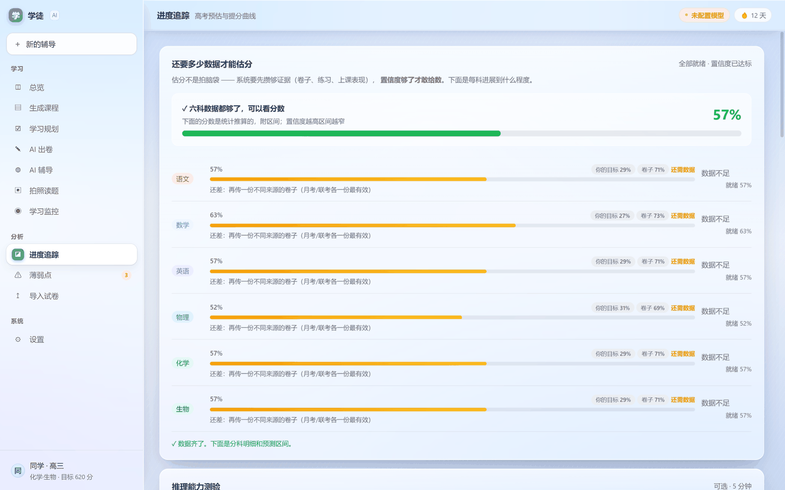
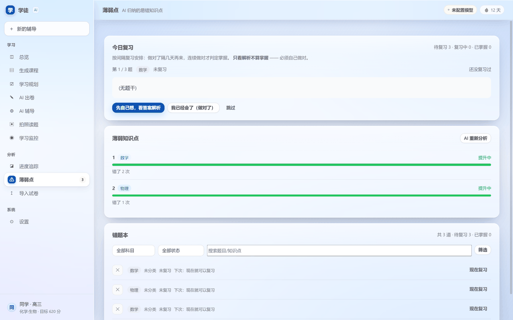
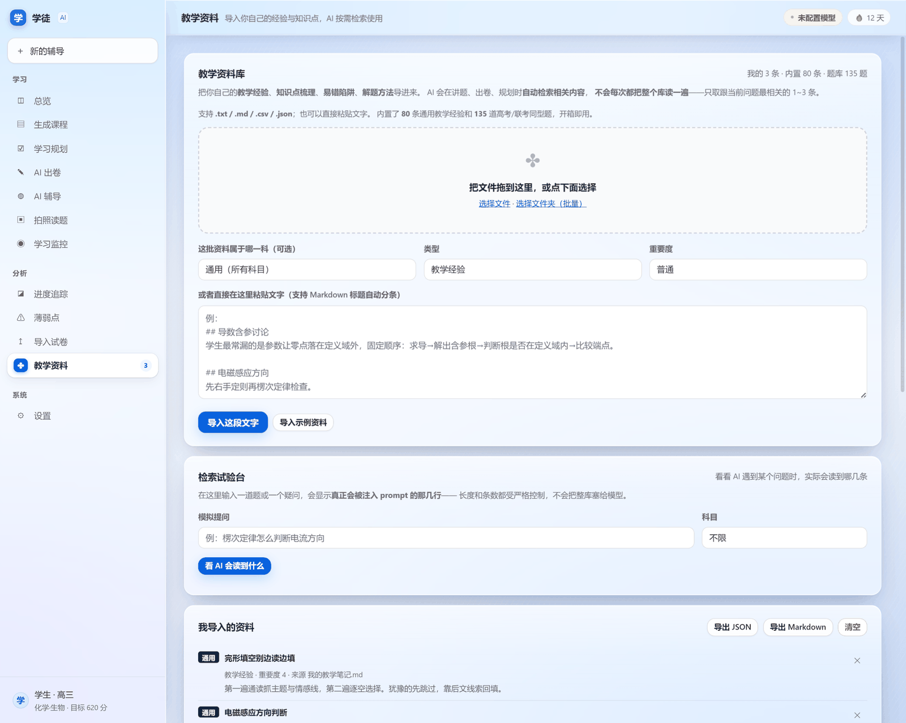
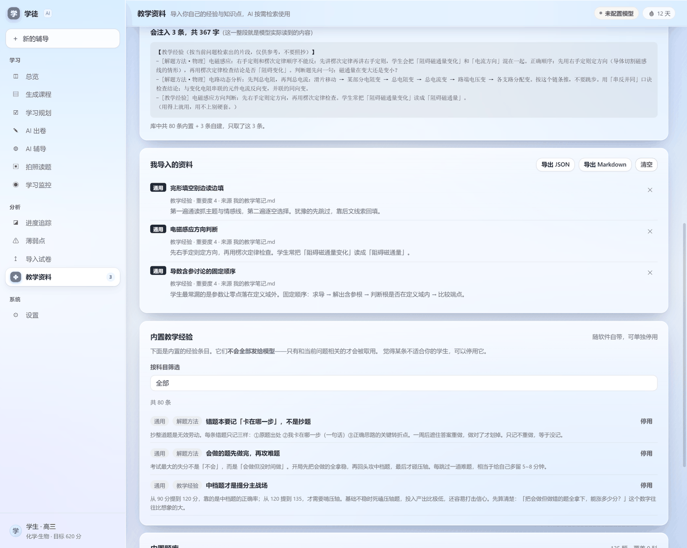

# 学徒 · AI 学习系统

> **AI 主动教，不是等你问。把高考变成一条能看见的进度条。**


**一个真正会主动找你的高考 AI 家教**——它先了解你，把高考拆成一条能走完的路，
然后每天告诉你「今天该做什么」。不用你一直问。


---

## 它长什么样

<table>
<tr>
<td width="50%"><br><sub><b>进度追踪</b> — 每科还差多少数据、离目标多远</sub></td>
<td width="50%"><br><sub><b>学习规划</b> — 今天该做什么，一眼看完</sub></td>
</tr>
<tr>
<td><br><sub><b>薄弱点诊断</b> — 从错题里找出真正卡住你的地方</sub></td>
<td><br><sub><b>教学资料</b> — 导入你自己的经验，AI 按需检索</sub></td>
</tr>
</table>

---

## 为什么不是又一个「AI 刷题软件」

市面上的 AI 学习工具大多是这样：你问它答，你不问它就不动。
但高考这件事，**最大的问题从来不是「没有题做」，而是「不知道今天该干什么」**。

学徒做法相反：它先花几分钟了解你（目标分、当前分、选科、薄弱点、每天能学多久），
把 6 科拆成一条进度条，然后**主动**开口——该复习了、这个知识点你还没掌握、
这周进度落后了、你离目标只差 44 分了。

---

## 快速开始

### 方式一：下载安装包，双击安装（推荐）

去 [**Releases**](https://github.com/zhouhengyi123/-xuetu/releases/latest) 下载安装包：

| 文件 | 大小 | 说明 |
|---|---|---|
| **`xuetu-slim-setup-1.1.0.exe`** | 84 MB | **推荐**。核心功能齐全，不含 DeepTutor 深度辅导 |
| `xuetu-full-setup-1.1.0.exe` | 284 MB | 完整版，含 DeepTutor（额外约 700 MB 磁盘，安装较慢） |

**双击 → 下一步 → 完成**，桌面上会出现「学徒 · AI 学习系统」图标。

> - 装到用户目录，**不需要管理员权限**
> - 卸载时**不会删除你的学习数据**（存档留在 `%APPDATA%\xuetu-app`）
> - 不用装 Node、不用装 Python，全部自带
> - 首次启动会引导你填一份问卷（约 3 分钟），填完就能看到自己的进度条
> - 首次还需要配一个大模型接口（软件**不预置任何密钥**）；也可以用 WorkBuddy 免费额度，基本不花钱
> - 安装包未做代码签名，Windows 可能提示「未知发布者」，点「更多信息 → 仍要运行」即可

### 方式二：从源码运行

```bash
# 需要 Node.js >= 18
git clone https://github.com/zhouhengyi123/-xuetu.git
cd xuetu
node scripts/setup-vendor.cjs    # 首次：下载第三方库（约 16 MB）
npm install
npm start
```

### 打包成安装包

```bash
# 便携版（免安装，解压即用）
node _build_exe.cjs

# NSIS 安装包（见 docs/构建安装包.md）
npm i -D electron-builder
npx electron-builder --win nsis --x64
```

---


---

## 教学资料：把你自己的经验喂给它

AI 默认只有通用的教学常识。但真正懂学生的，是你自己——
你带过几届、知道「导数含参讨论学生总漏定义域」这种细节。

**教学资料**页让你把这些导进来，AI 讲题、出卷、规划时会自动用上。


### 支持什么

| 来源 | 说明 |
|---|---|
| 拖入文件 | `.txt` / `.md` / `.csv` / `.json`，可整个文件夹批量导 |
| 直接粘贴 | 支持 Markdown 标题自动分条 |
| 内置 | **80 条**通用教学经验（各科易错点、解题方法、教学法） |
| 内置题库 | **135 道**高考同型 / 联考典型题，供出卷兜底 |

### 关键：不会把整库读一遍

这是设计上最在意的一点。库里可能上百条，但**每次只注入 1~3 条**：

- 按「科目 + 问题关键词」打分检索，中文二元组匹配
- 有相关性门槛：标题/标签命中，或正文命中足够多才算数
- **一条都不相关时，什么都不注入**（返回空，而不是硬塞）
- 每次注入硬上限约 1200 字，平均实测不到 100 字

页面上有个「检索试验台」，直接显示**模型实际读到的那几行**：



上图：库里有 80 条内置 + 3 条自建，问「楞次定律怎么判断电流方向」，
只取了 3 条共 367 字。换个无关的问题，就会显示「没有检索到相关内容」。

### 数据怎么用起来的

注入点只有一个：`shared/memory.js` 的 `Memory.context()` 和 `web/js/app.js` 的 `persona()`。
后者是 `LLM.setPersona` 的唯一来源——改一处，
快速问答 / 出卷 / 批改 / 规划 / 估算 / 答疑 **全部生效**。

内置经验可以单条停用；自己导入的资料可删除、可导出 JSON / Markdown。

---

## 三个真正的卖点

### ① 高考 = 一条能看见的进度条

高考不是"还有 219 天"，而是一段**你正在走的距离**。

```
577 分 · 推算（3/6 科有数据）        目标 620 分 · 还差 43 分
[━━━━━━━━━━━━━━━━━━━━●━━━━━━━━━━━]   57% · 突破阶段
起点 520                              目标 620

  ●  ——●———————●—————————○—————————○
 筑基    提分      突破      冲刺      决战
              攻中档题，把会的变成对的

距高考                                  219 天

各科进度
数学  [━━━━━━━━━━━━━━━━━━━━━━━━━━]  101/150
英语  [━━━━━━━━━━━━━━━━━━━━━━━━━━]  109/150
物理  [━━━━━━━━━━━━━━━━━━━━━━]       72/100
语文  待录入
```

**五个游戏阶段**，每段告诉你现在该做什么：

| 阶段 | 区间 | 该做什么 |
|---|---|---|
| 筑基 | 0-20% | 把基础概念补齐，别急着做难题 |
| 提分 | 20-45% | 按题型专项练，抓稳定分 |
| **突破** | 45-70% | 攻中档题，把会的变成对的 |
| 冲刺 | 70-90% | 压缩失误，稳住已经拿到的 |
| 决战 | 90-100% | 只做三件事：真题、错题、作息 |

**让努力可见**：今天做了事，进度条就动，显示「↑ 今天已让进度条动了 3.0 分」。

---

### ② 主动式 AI —— 老师先开口

真正的老师不会等学生来问，他会主动找你。

| 类型 | 触发 | 示例 |
|---|---|---|
| 🤔 缺口追问 | AI 了解你 < 45% | 「我想更了解你 —— 现在只有 20%，缺的是：上传试卷」 |
| ⏰ 复习提醒 | ≥3 道题到期 | 「有 3 道题该复习了 —— 今天不复习就会忘」 |
| ⏰ 学习提醒 | 4 天没动静 | 「5 天没动静了 —— 先做 5 道题，做着做着就进去了」 |
| 🎉 进度庆祝 | 完成度 ≥75% | 「你已经走到 84% 了，剩下的是每科再提一点点」 |
| 👋 启动问候 | 前四项都没有 | 「晚上好。距期中考还有 15 天，现在开始不算晚」 |

**设计原则**

- **不打扰** —— 同一类提醒一天最多一次
- **有理由** —— 每条都说清楚"为什么现在说"
- **可执行** —— 不是"加油"，是「去复习」按钮
- **老师口吻** —— 像班主任，不像客服

---

### ③ 基本免费 —— 复用 WorkBuddy 积分

**不花自己的 API 钱。**

如果你本机装了 WorkBuddy 桌面版且已登录，软件会**直接复用它的积分**：

```
使用 WorkBuddy Token（免费）    已启用
✓ 6 个账号，连接正常
用时 5111ms · 模型 hy4-preview
```

开了之后，所有 AI 调用都走 WorkBuddy —— 不消耗你自己的 Key。

> 这是非官方能力，靠 WorkBuddy 本地登录态工作。平台改接口或风控时可能失效，只建议个人测试用。

---

## 它还有哪些能力

| 功能 | 说明 |
|---|---|
| **证据驱动估分** | 贝叶斯精度加权融合。置信不足只给区间，不编精确数字 |
| **AI 出卷 + 逐题判分** | 客观题确定性判断，主观题按评分点给分，拿不准标「待确认」让你改判 |
| **错题本 + 间隔复习** | 简化 SM-2。**只看解析不算掌握**，必须独立做对 + 隔天验证 |
| **三合一 AI 辅导** | 讲题 / 补知识点 / 检查掌握 / 做演示，系统自动选底层 |
| **18 个 Agent 工具** | 跑代码 · 画图表 · 做 3D 场景 · 生成动画 · 导出视频 |
| **学习状态监控** | MediaPipe 本地识别：书写 / 阅读 / 听讲 / 思考 / 分心 |
| **全 AI 记忆共享** | 4 个 AI（问答/三合一/Agent/深度辅导）共用同一份档案 |
| **了解程度门禁** | AI 不够了解你时，出卷/规划显示引导卡而不是硬跑 |

---

## 技术架构

```
┌─────────────────────────────────────────────┐
│  界面层  web/（Electron 直接加载）            │
│  侧栏 + 环境光 + 19 个动画                    │
└──────────────────┬──────────────────────────┘
                   │
┌──────────────────▼──────────────────────────┐
│  记忆中枢  shared/memory.js                  │
│  ┌────────┬────────┬────────┐               │
│  │档案记忆│对话记忆│事件记忆│               │
│  └────────┴────────┴────────┘               │
│         ↓ 所有 AI 唯一入口                   │
└──────────────────┬──────────────────────────┘
                   │
      ┌────────────┼────────────┬─────────────┐
      ▼            ▼            ▼             ▼
   快速问答     三合一       Agent       深度辅导
  (DeepSeek)  (TutorHub)  (18工具)   (DeepTutor)
```

**记忆三层**

- **档案记忆** —— 起点、目标、选科、知识点（学生是谁）
- **对话记忆** —— 最近 40 轮（防止重复问、重复讲）
- **事件记忆** —— 做过什么（AI 知道你这几天干了什么）

**离线优先**：Three.js（655 KB）+ MediaPipe（16 MB）全部内嵌，不依赖 CDN。
## 隐私

**所有学习数据只存在你电脑上**（`%APPDATA%/xuetu-app`）

- 人脸画面**只在本地处理**，不上传
- 匿名使用统计**默认关闭**，只有你主动开才上报
- 只发：随机 ID + 启动次数 + 版本号
- **绝不发**：成绩、错题、对话、姓名、学校、IP

---

## 技术栈

| 层 | 用的什么 |
|---|---|
| 桌面框架 | Electron 33 |
| 主模型 | DeepSeek-V4 Pro / Flash（实测可用） |
| 深度辅导 | DeepTutor（本地 FastAPI + Next.js） |
| 3D 场景 | Three.js 0.160（内嵌） |
| 人脸识别 | MediaPipe FaceMesh（内嵌） |
| 免费额度 | WorkBuddy（复用本机积分） |
| 数据存储 | localStorage + 磁盘镜像 |

支持 9 家模型厂商：OpenAI(GPT-6) / DeepSeek / Anthropic(Claude 5.5) / 千问(3.8) / Kimi(K3.1) / 智谱(GLM-5.3) / MiniMax / LongCat / 自定义。

---

## 开源协议

MIT —— 自由使用、修改、分发。

---

## 致谢

- [DeepSeek](https://www.deepseek.com/) —— 模型支持
- [DeepTutor](https://github.com/HKUDS/DeepTutor) —— 深度辅导引擎
- [MediaPipe](https://mediapipe.dev/) —— 本地人脸检测
- [Three.js](https://threejs.org/) —— 3D 渲染
- [Proctoring-AI](https://github.com/vardanagarwal/Proctoring-AI) —— 监控引擎参考

---

## 一句话收尾

**大多数 AI 家教对你一无所知，却敢给你估分、出题、排计划。**

学徒不一样：**数据不足只给区间，不够了解你就不出题，必须独立做对才算掌握。**

**AI 先了解你，再教你。不了解你，它不编故事。**
